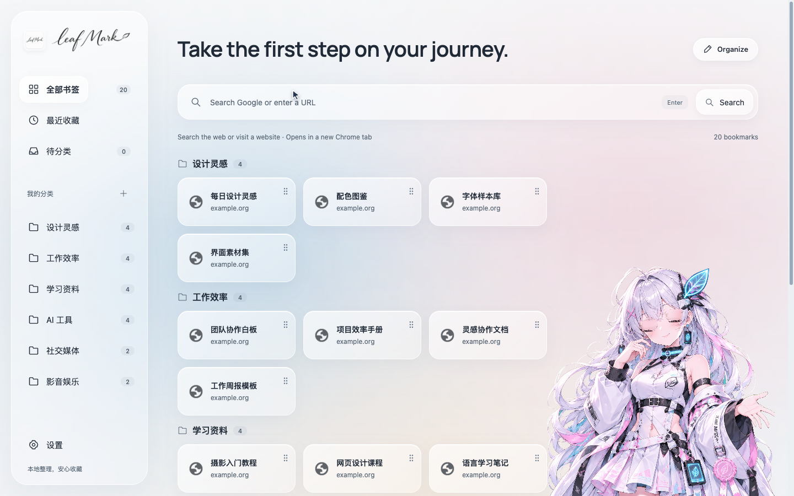

# Leaf Mark

把挤在书签栏里的收藏，铺成一个清晰的桌面。

一个采用浅色液态玻璃界面、动态粉蓝背景和手写品牌标识的 Chrome 书签导航与全网搜索插件。默认点击插件图标打开，也可在设置里主动开启启动和新标签页入口。自动读取现有书签，按类别展示，通过分类浏览收藏，也可搜索 Google 或直接访问网址。原生 HTML / CSS / JavaScript，无需安装依赖或构建。



*截图来自隔离测试环境，展示的是示例书签。安装后会显示你自己的收藏；网站图标取决于浏览器缓存。*

## 功能

- **全部铺开**：书签按分类、多列网格展示，自动换行，向下滚动查看，没有「更多」折叠菜单。
- **本地自动分类**：根据域名和标题推荐 AI 工具、设计灵感、工作效率、学习资料、社交媒体、影音娱乐；无法识别的进入「待分类」。
- **全网搜索与网址直达**：输入关键词后按回车或点击 Search，打开 Google 搜索；输入域名或 http/https 网址，直接在 Chrome 新标签页访问。输入过程中不筛选书签、不发送请求，不保存搜索历史。
- **白色图标适配**：自动将带透明背景的白色或近白色单色 Logo 显示为黑色，保留透明轮廓；彩色和黑白混合图标保持原样。检测在本地完成。
- **浅色动态玻璃 UI**：浅灰白底、柔和粉蓝与暖白光场缓慢流动，轻微跟随鼠标；侧栏、卡片、搜索框与菜单使用浅色玻璃，深色文字。后台标签页暂停背景动画，触屏不跟随指针，减少动态效果时静止。英文标题使用本地 Manrope SemiBold，保留 1.5 秒下滑渐显。
- **顺滑排序**：分类内书签和左侧分类文件夹均可拖动排序，相邻项目平滑让位；分类顺序同步到「全部书签」分组，本地保存。侧栏高亮底块随鼠标滑动，文字与图标保持位置。
- **手动整理**：拖动书签到分类，或点击 Organize使用下拉菜单；支持新建自定义分类，默认与自定义分类均可重命名和删除。
- **最近收藏**：按收藏时间从新到旧浏览全部书签。
- **空分类可见**：没有书签的分类也保留「拖动书签到这里」区域，可直接拖入。
- **书签改名与删除**：右键重命名只改变本地显示名；右键删除需要确认，会同时删除 Chrome 原书签。删除分类仍保留其中的书签。
- **可选启动入口**：设置中主动开启并授予可选标签页权限后，启动 Chrome 或新建默认标签页时显示 Leaf Mark；关闭后恢复原有打开方式。
- **动态助手**：右下角人物循环待机，点击后弹出「今天想做点什么呢？」玻璃气泡，220 毫秒轻微上移渐显；再次点击、点击空白处或按 Escape 关闭。人物不挥手；系统减少动态效果时显示静态人物，气泡直接出现。
- **实时更新**：在 Chrome 中新增、修改或删除书签时，桌面随之更新。
- **书签右键菜单**：提供新标签页打开、新窗口打开、链接另存为、复制地址、重命名、删除书签和 Chrome 原生检查入口，不含拆分视图或隐身窗口选项。
- **本机处理**：本地分类不依赖云端 AI；主动全网搜索由 Google 提供，保留原有书签及文件夹结构。

## 安装

需要 Chrome 114 或更高版本。目前通过开发者模式本地加载，尚未在 Chrome 应用商店发布。

1. 在本仓库页面点击 **Code → Download ZIP**，解压到固定位置；也可以克隆本仓库。
2. 在 Chrome 地址栏输入 `chrome://extensions`，打开右上角的 **开发者模式**。
3. 点击 **加载已解压的扩展程序**，选择解压后的 **extension 文件夹**。
4. 点击 Chrome 工具栏右侧的扩展程序图标（拼图），在列表中点击 **Leaf Mark**，即可打开。

**选择的文件夹内应直接包含 `manifest.json`。不要选择 ZIP，也不要选择外层项目文件夹。** 安装后请保留该文件夹；移动或删除它会影响插件加载。

可将 Leaf Mark 固定到工具栏，之后直接点击其图标使用。默认不自动打开，也不改变原有新标签页。需要时在「设置」开启「将 Leaf Mark 设为启动页和新标签页」并允许 Chrome 的标签页权限提示。关闭开关后停止自动打开。原来的恢复会话或启动网页仍然保留；开启功能时可能额外打开 Leaf Mark，而非覆盖恢复的网页。

### 更新与卸载

更新时关闭已打开的插件页面，在原安装路径更新 `extension/` 中的文件，进入 `chrome://extensions` 点击插件的重新加载按钮，再点击工具栏的插件图标打开。保留原路径，不要先卸载，以免丢失本地分类、显示名称和排序。新增的启动入口默认关闭，需要你主动开启。

卸载时在扩展程序页面点击「移除」。原有 Chrome 书签仍保留，但插件的手动分类和设置会被清除。

## 使用

| 操作 | 方法 |
| --- | --- |
| 浏览某一类书签 | 点击左侧分类 |
| 书签排序 | 按住卡片或右上角手柄拖动；仅保存在 Leaf Mark 内，最近收藏仍按时间排列 |
| 分类排序 | 按住左侧分类拖动；侧栏留白也可松手，下方空白排至最后；右侧分组同步顺序，三个固定入口不参与排序 |
| 键盘排序 / 取消 | 聚焦书签或分类后按 Alt + 方向键；拖动时按 Esc 或在无效区域松开可取消 |
| 调整分类 | 拖到左侧分类，或点击 Organize后使用下拉菜单 |
| 待分类归类 | 此页始终显示分类下拉框；按住卡片或右上角拖动手柄，拖到高亮的左侧分类文件夹后松开 |
| 书签右键操作 | 右键卡片打开菜单；方向键选择，回车执行，Escape 或点击外部关闭 |
| 重命名书签 | 右键书签 → 重命名；输入 1–200 个字符，保存到 Leaf Mark 本地显示名 |
| 删除书签 | 右键书签 → 删除书签 → 核对名称和网址后确认；会删除 Chrome 原书签 |
| 新建分类 | 点击「我的分类」旁的加号，名称为 1–20 个字符且不可重复 |
| 重命名分类 | 右键分类，选择「重命名」，修改后保存；按 Escape 或叉号取消，分类中的书签归属保留 |
| 删除分类 | 右键分类，选择「删除」，确认后其中的书签移至「待分类」，保留网址和 Chrome 原始书签 |
| 全网搜索 / 网址直达 | 输入关键词或网址，按回车或点 Search；始终在新标签页打开 |
| 快捷搜索 | 按 `/` 聚焦搜索框，搜索中按 `Escape` 清空 |
| 保留桌面打开网站 | 在「设置」中开启「在新标签页打开书签」，默认开启 |
| 助手气泡 | 左键点击右下角人物；键盘聚焦人物后按回车或空格也可打开 |
| 启动和新标签页入口 | 设置中主动开启；默认关闭，拒绝权限时保持关闭 |

界面也适应窄窗口。

分类右键菜单有「重命名」和「删除」两项。删除书签或分类前会显示确认提示。

## 隐私与权限

插件使用 `bookmarks`、`storage`、`favicon` 三项基础权限，用于读取及经确认后删除书签、本地保存分类与设置、显示网站图标。首次使用「链接另存为」时申请可选的 `downloads` 权限；主动开启启动入口时申请可选的 `tabs` 权限，关闭后撤销。拒绝可选权限不影响其他功能。不申请网页访问权限，不注入网页脚本，不设置分析统计或书签上传服务。

详细说明见 [PRIVACY.md](PRIVACY.md)。

## 已知限制

- 自动分类使用有限的本地域名和标题规则，可能误判，可手动纠正。
- 只能改变插件页面内的书签展示，无法改变 Chrome 原生书签栏或取消其溢出菜单。
- 分类仅保存在当前浏览器的本地插件存储中，不跨设备同步，也未提供分类导入导出。
- 「全部书签」「最近收藏」「待分类」是固定功能入口，不参与重命名和删除。
- 删除默认分类后，已有成员及以后原本会自动进入该分类的新书签进入「待分类」。本版没有恢复已删除分类的入口，可新建同名自定义分类并手动归类。
- `javascript:`、`data:` 等书签会展示，但不会在插件中执行；本地文件及浏览器内部地址的打开行为受浏览器限制。
- 网站图标来自 Chrome favicon 接口。没有缓存时可能显示通用图标，加载失败时显示名称首字。
- 未进行万级书签负载测试。
- 人物使用约 9.6 MiB 的透明 VP9 WebM，保留 1254×1254、30 帧/秒和原有约 6 秒动作；后台页面暂停，无法播放时回退到静态人物。气泡目前只显示问候语，未接入客服对话、文档转换或翻译服务。
- 自定义菜单中的「检查」会提示再次右键同一书签，然后在 Chrome 原生菜单中执行检查；普通扩展页面不能直接调用 Chrome 的同名开发者工具命令。也可按住 Shift 右键使用原生菜单。
- 「链接另存为」仅支持 HTTP/HTTPS，交由 Chrome 下载系统及保存对话框处理，仍受浏览器下载策略和网站响应限制。

## 开发与验证

开发测试需要 **Node.js 22 或更高版本**。不需要运行 `npm install`。

```sh
node --test tests/core.test.mjs
node --check extension/app.mjs
node --check extension/favicon.mjs
node --check extension/motion.mjs
node --check extension/background.js
```

当前包含 20 项测试，覆盖白色图标判断、本地排序、书签树读取、分类规则、手动分类优先级、分类改名及名称校验、分类删除与书签归属保留、全网搜索 URL 解析与编码、安全链接、存储分类结构及插件资源完整性。GitHub Actions 会在 push 和 pull request 时执行这些检查，也可手动触发。

界面或浏览器接口有变化时，还需在独立 Chrome 配置中手动检查：浏览器新标签页保持原样、工具栏按钮、空列表、回车与 Search 提交、网址直达、输入不筛选书签、导航失败重试、减少动态效果、分类右键菜单、分类保存、新建分类、拖动、书签实时增删和窄窗口布局。自动测试不替代浏览器实测。

### 项目结构

```text
extension/                 Chrome 可加载的插件目录
  manifest.json            权限与插件入口配置
  newtab.html              页面结构
  styles.css               浅色玻璃、流动背景、1.5 秒标题动画与响应式布局
  app.mjs                  交互、书签读取与分类保存
  bookmark-actions.mjs     右键菜单的打开、复制与另存为操作
  motion.mjs               滑动高亮、跟手拖动、相邻项目让位与键盘排序
  core.mjs                 分类、排序与数据处理
  search.mjs               全网搜索与网址解析
  favicon.mjs              白色图标检测与浅色背景适配
  background.js            工具栏点击入口
  icons/                   插件图标
  assets/                  本地品牌素材、工具栏原图与 Manrope 字体
tests/core.test.mjs        无外部依赖的逻辑与资源测试
.github/workflows/test.yml GitHub 自动检查
docs/                     截图与 GitHub 上传指南
PRIVACY.md                隐私与权限说明
CHANGELOG.md              版本记录
```

修改分类规则可编辑 `extension/core.mjs`，并补充相应测试。提交问题时请描述操作步骤、Chrome 版本及报错；截图和日志中的私人书签、网址请先打码。

## 上传与项目状态

使用整理好的 `leaf-mark-github-v1.10.3.zip` 时，先解压并上传 `leaf-mark` 文件夹内的内容。首次上传请参阅 [GitHub 上传指南](docs/github-upload.md)。新仓库可命名为 `leaf-mark`，已有仓库无需因品牌更新而迁移。

当前版本为 `1.10.3`，详见 [版本记录](CHANGELOG.md)。旧动漫壁纸已移除，背景由本地 CSS 渐变绘制，等比例图片缩放限制不再适用。浅蓝、柔粉与暖白色场缓慢循环；鼠标移动只产生最多约 14px 水平、10px 垂直偏移，控件保持稳定。页面艺术字保持透明背景，并通过 CSS 显示为深色。动态助手使用随插件提供的透明 WebM 和静态 PNG，运行时不请求第三方人物、背景或字体服务。尚未指定项目开源许可证，本仓库暂未附带 `LICENSE` 文件。

### 字体

标题字体 [Manrope](https://github.com/google/fonts/tree/main/ofl/manrope) 随插件本地打包，不访问在线字体服务。字体采用 SIL Open Font License 1.1，原许可证见 [OFL.txt](extension/assets/fonts/OFL.txt)。
